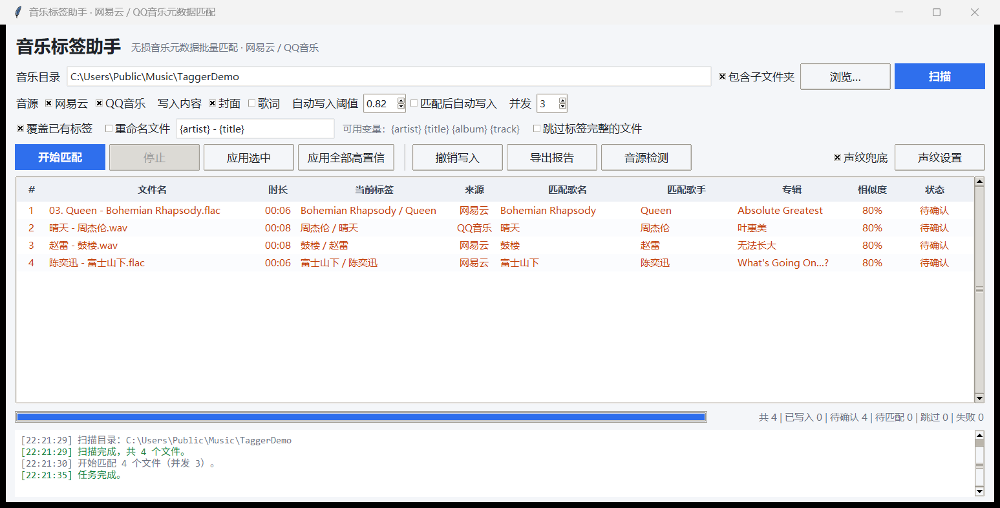

# 音乐标签助手

[](https://github.com/FuguiDing/music-tagger/actions/workflows/ci.yml)
[](https://github.com/FuguiDing/music-tagger/releases)
[](LICENSE)

无损音乐元数据批量匹配工具：扫描本地 FLAC / WAV / APE 等音频，自动从 **网易云音乐** 与 **QQ音乐** 检索匹配，批量写入歌名、歌手、专辑、专辑艺术家、发行日期、音轨号、封面图与歌词，支持一键撤销。

## 快速开始

直接双击 **音乐标签助手.exe**（无需安装 Python）：

1. 选择音乐目录 → 点「扫描」
2. 点「开始匹配」，程序并发搜索两个音源并按相似度打分
3. 相似度 ≥ 阈值（默认 0.82）的结果在勾选「匹配后自动写入」时直接写入；其余标为「待确认」
4. 双击任意一行可手动搜索、更换匹配结果；右键可打开文件位置、跳过
5. 「应用选中」「应用全部高置信」可分批写入；写错可点「撤销写入」回滚

## 界面预览




## 支持格式

`.flac` `.wav` `.mp3` `.m4a/.aac` `.ape` `.wv` `.ogg` `.opus` `.aiff`

- FLAC / OGG / OPUS：Vorbis Comment + 内嵌封面
- WAV / MP3 / AIFF：ID3v2 标签（WAV 写入 ID3 区块，绝大多数播放器兼容）
- M4A / MP4：iTunes 风格原子标签
- APE / WV：APEv2 标签

## 安全机制

- 每次批量写入前，原标签自动备份到 `%LOCALAPPDATA%\MusicTagger\backups\undo_*.json`
- 「撤销写入」可还原文本标签；封面若原本没有则一并移除
- 「导出报告」生成 CSV（含路径、匹配结果、相似度、状态），便于核对

## 匹配策略

- 文件名解析：自动剥离 `01.` 等音轨前缀，兼容 `歌手 - 歌名` / `歌名 - 歌手` / `歌手 - 专辑 - 01 - 歌名` 等命名
- 打分：歌名相似度 52% + 歌手相似度 28% + 时长接近度 16% + 专辑相似度 4%；时长相差超过 12 秒显著降权；候选带 Live / Cover / 伴奏 / Remix 等标记而本地没有时自动降权，避免翻唱、现场版误配
- 无正规标签的文件会同时按两种“歌名-歌手”顺序打分

## 声纹兜底（v1.2 新增）

当文件名和标签都帮不上忙时（`track01.flac`、`未知艺术家.mp3`，或文本匹配置信度不足），程序可用**音频指纹**直接识别歌曲，无需任何文字线索：

- **AcoustID（Chromaprint）**：免费稳定，欧美曲库覆盖好，华语流行命中率偏低。内置 fpcalc 工具，无需安装任何东西。
- **Shazam**：华语覆盖极好。对 Live 专辑、长前奏的歌曲采用「多个 12 秒短片段 + 投票」策略，显著降低误识别；连续请求被限流时自动暂停 5 分钟后恢复。
- **二次校验**：声纹只回答「这是什么歌」，随后仍回到网易云 / QQ 音乐检索，用文本相似度确认后才采纳——音源确认的条目会补全专辑、封面、歌词；音源查不到时退而写入声纹给出的歌名 / 歌手 / 专辑（界面「来源」列带 ♪ 标记）。
- 识别结果同样可在「待确认」列表中人工核对、双击改选。
- 声纹每首约 2~10 秒（Live 专辑更久），只在文本匹配不足时触发；不需要时在按钮行取消勾选「声纹兜底」即可。
- AcoustID 默认使用公共客户端密钥；如需独立配额，可在 [acoustid.org/new-application](https://acoustid.org/new-application) 免费申请自己的密钥，在「声纹设置」里填入。

## 说明与注意

- 网易云 / QQ 音乐使用的是其网页端公开接口，**仅供个人整理本地已购买音乐的标签信息，请勿用于下载或分发受版权保护的内容**。接口为非官方，若失效请关注更新。
- QQ 音乐接口有请求频率限制：触发风控时程序会自动切换备用通道并在 15 分钟后重试主通道；大量文件建议分批匹配（并发建议 2~3）。
- 部分歌曲（如周杰伦部分作品）不在网易云曲库，会自动从 QQ 音乐匹配。
- 「重命名文件」默认模板 `{artist} - {title}`，支持 `{album}` `{track}` 变量。

## 开发

```bash
pip install -r requirements.txt            # 依赖
python main.py                             # 源码直接运行

python tools/fetch_fpcalc.py               # 可选：下载 Chromaprint 指纹工具（声纹 AcoustID 引擎用）
python build.py                            # 打包为单文件 exe → dist/MusicTagger.exe
```

测试（`tests/`）：

```bash
python tests/test_sources.py               # 网易云 / QQ音乐接口连通性
python tests/test_pipeline.py              # 匹配流水线（自动生成测试音频）
python tests/test_write.py                 # 写入 → 读回 → 撤销 全流程
python tests/test_gui.py                   # 界面冒烟测试
```

> 部分测试会读取 `tests/_samples/` 下的音频文件，该目录不入库（避免分发版权内容）。
> 自行放入几首测试曲目即可运行；`test_pipeline.py` 不需要样本，会现场合成音频。

源码结构：

| 路径 | 作用 |
|---|---|
| `main.py` | 程序入口 |
| `mtcore/sources.py` | 网易云、QQ音乐接口封装（含 QQ 三通道降级与限速） |
| `mtcore/media.py` | 各格式标签读写、封面/歌词内嵌、备份与撤销 |
| `mtcore/matcher.py` | 候选打分与排序（标题/歌手/时长/专辑加权 + 版本降权） |
| `mtcore/textutil.py` | 文本归一化、文件名解析、占位名判定 |
| `mtcore/fingerprint.py` | 声纹兜底：AcoustID 与 Shazam 双引擎 |
| `mtcore/pipeline.py` | 搜索、声纹、写入的流水线编排（界面只调这一层） |
| `mtcore/app.py` | Tkinter 图形界面 |

## 许可

MIT License，详见 [LICENSE](LICENSE)。

第三方组件：`tools/fpcalc.exe` 来自 [Chromaprint](https://github.com/acoustid/chromaprint)（LGPL-2.1），
不在本仓库内分发，由 `tools/fetch_fpcalc.py` 按需下载。
